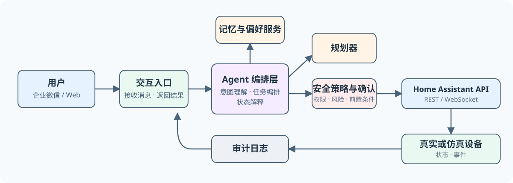
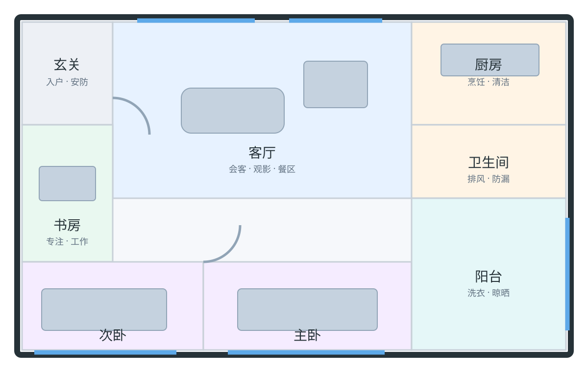

# Home Assistant Agent

> 面向 Home Assistant 的、具备长期偏好记忆与安全执行机制的智能家居 Agent。

Home Assistant Agent 让用户用自然语言表达生活需求，而不仅是下达设备指令。它在理解家庭实时状态和用户习惯的基础上，规划并安全地执行家居操作；未来将接入企业微信，成为随时可用的家庭协作入口。

## 为什么做这个项目？

许多智能家居 Demo 只能完成“把客厅灯打开”这类单轮指令。本项目关注更接近真实生活的问题：

- “我有点热”应当结合所在房间、温湿度和空调状态，给出合理行动。
- “我要睡了”可能意味着关灯、调整空调、拉窗帘、检查门锁，而不是单一的预设脚本。
- Agent 应能从用户的接受、拒绝与纠正中学习偏好，同时保证关键操作始终受安全规则约束。

## 核心能力

- **自然语言控制**：将模糊的生活表达映射为可执行的家庭任务。
- **上下文感知**：综合时间、位置/在离家状态、传感器与设备状态进行决策。
- **偏好记忆**：区分长期稳定偏好与短期会话上下文，并支持用户查看、修正和删除。
- **多步任务规划**：把一个生活目标拆解为多个有序、可恢复的设备操作。
- **安全执行层**：模型只能提出行动计划；策略引擎负责校验风险、权限、前置条件和二次确认。
- **可解释与可追溯**：每次执行都记录“做了什么、为什么做、结果如何”。

## 系统概览



## 关键设计原则

1. **安全优先**：门锁、安防、摄像头与高能耗操作遵循更严格的权限与确认规则。
2. **建议优先于擅自自动化**：习惯学习的初期先提出建议，只有在用户明确授权后才自动执行。
3. **确定性边界**：LLM 负责理解与规划；设备调用、参数校验、权限判断和审计必须可预测、可测试。
4. **平台解耦**：企业微信仅是一个接入渠道，核心能力不依赖特定 IM 平台。

## MVP 范围

第一阶段将基于 Home Assistant 的仿真环境，覆盖灯光、空调、窗帘、传感器与门锁等实体：

- 通过聊天入口完成设备查询与控制。
- 支持“回家”“准备睡觉”“有点热”等典型意图。
- 基于实时状态生成并执行多步计划。
- 对高风险服务调用进行确认与审计。
- 保存基础偏好，并根据用户纠正更新偏好。

企业微信接入、语音交互、更复杂的自动化学习和真实设备集成将在核心闭环稳定后逐步加入。

## 示例交互

```text
用户：我准备睡觉了
Agent：检测到卧室温度 27.2°C、窗帘未关闭，入户门已上锁。
       按你的睡眠偏好，我建议关闭客厅灯、关闭卧室窗帘，
       将卧室空调设为 25°C 睡眠模式。是否执行？

用户：执行
Agent：已完成：客厅灯已关闭、卧室窗帘已关闭、空调已设为 25°C 睡眠模式。
```

## 规划中的技术栈

- **智能家居平台**：Home Assistant + REST/WebSocket API
- **Agent 服务**：Python（具体框架将在架构设计阶段确定）
- **状态与记忆**：结构化设备状态 + 可检索的偏好记忆
- **渠道**：Web 调试入口，后续企业微信机器人/应用
- **可观测性**：结构化日志、任务审计与执行轨迹

## 路线图

- [x] 明确项目定位与 MVP
- [x] 搭建 Home Assistant 仿真环境与三室一厅数字孪生看板
- [ ] 实现实体发现与安全的服务调用工具
- [ ] 完成聊天控制与状态查询闭环
- [ ] 实现多步规划、确认和审计
- [ ] 加入偏好记忆与纠正反馈
- [ ] 接入企业微信
- [ ] 构建场景评测集与演示案例

## 今日进展（2026-08-12）

第一阶段的 Home Assistant 仿真环境已经完成，当前仓库不再只是设计文档，而是有一套可以启动、观察和通过 API 控制的虚拟家庭。

- 使用 Docker Compose 启动官方 Home Assistant Container，并将运行配置持久化在仓库的 `homeassistant/` 目录。
- 建模了一套约 120㎡ 的三室一厅：玄关、客厅、主卧、次卧、书房、厨房、卫生间和阳台。
- 配置了灯光、空调、风扇、窗帘、门锁、油烟机、洗碗机、洗衣机、电动晾衣架，以及温度、湿度、PM2.5、燃气和漏水等传感器/安防实体。
- 在 Home Assistant 中完成实体与区域的归属；后续 Agent 可以以“房间 + 设备”的自然语言结构定位调用目标。
- 新增侧边栏 **家庭数字孪生**：平面图会实时映射实体状态；点击设备图标可查看详情或控制设备。Agent 后续触发服务时，同一界面会同步展示结果。
- 完成 Home Assistant 配置校验，并验证 REST API 可读取状态、调用设备服务。

### 当前数字孪生平面图

下图为仪表盘使用的 120㎡ 户型底图。运行后，设备状态图标会贴边显示在对应房间，避免遮挡房间标题；客厅环境数据在下方留白区域显示。



> 实际交互界面在 Home Assistant 左侧的 **家庭数字孪生** 中打开。图标的颜色与状态会随设备实时变化。

## 本地仿真实验室

仓库内置 Docker 化的 Home Assistant 虚拟公寓，提供标准 Home Assistant 实体域，可直接通过官方 REST API 控制。

```powershell
docker compose up -d
```

启动后访问 [http://localhost:8123](http://localhost:8123)，首次运行时创建本地管理员账户；随后在侧边栏进入 **家庭数字孪生** 即可看到实时平面图。

实体清单、区域映射、Token 创建、REST API 示例和配置校验步骤见 [仿真实验室说明](docs/home-assistant-lab.md)。

## 当前实体覆盖

| 区域 | 已模拟的主要设备 | Agent 可验证的能力 |
| --- | --- | --- |
| 玄关 | 灯、入户门锁、门磁、安防 | 回家/离家与安全确认 |
| 客厅 | 三路灯光、空调、窗帘、空气净化器、温度、PM2.5 | 舒适度调节、观影模式 |
| 主卧 / 次卧 | 灯、空调、窗帘、温度 | 睡眠、起床、节能控制 |
| 书房 | 灯、风扇 | 专注与离开场景 |
| 厨房 | 灯、油烟机、洗碗机、燃气报警 | 烹饪安全、饭后清洁 |
| 卫生间 | 灯、排风扇、湿度、漏水报警 | 除湿、漏水告警 |
| 阳台 | 灯、洗衣机、电动晾衣架 | 洗衣与晾晒 |

## 项目状态

目前已完成“可控仿真家庭 + 可视化状态面板”的基础设施。下一步将实现实体发现、受安全策略约束的服务调用工具，并将自然语言意图接入 Agent 执行闭环。

## License

待确定。
